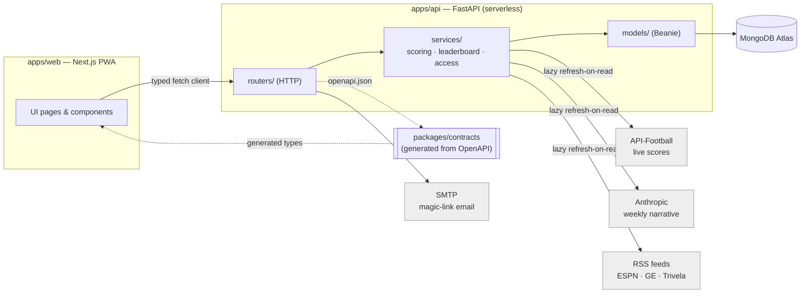

# Social dos Palpiteiros: how it was built, and why

*A technical retrospective on the architecture and development process behind a World Cup
2026 prediction-pool app — written for an audience that wants the real engineering story,
not marketing copy. Every claim below is drawn from the project's own commit history and
source code.*

## What it is

Social dos Palpiteiros ("the social club of predictors") is a PWA where friends form private
pools, predict World Cup match scores, and compete on a points leaderboard that escalates in
value as the tournament progresses. It shipped as a side project tracking the real FIFA World
Cup 2026 calendar — group stage through final — and was built, released, and iterated on
*during* the tournament it covers, not before it.

## What was built

- **Pools and predictions.** Friends create a pool with an invite code, predict every match's
  score before kickoff, and the pool's own tiny membership list lives embedded in the pool
  document — no separate membership table to join.
- **A scoring system that evolved live.** Points reward accuracy (exact score > near-miss >
  correct goal margin > correct outcome) multiplied by an escalating per-round weight, so a
  group-stage lead can't coast into the final. The rules were revised once, mid-tournament,
  based on player feedback — and the codebase versions that change by match kickoff time
  rather than retroactively rescoring already-played matches. Knockout rounds add two
  independent picks: who advances, and the penalty-shootout score, each scored on their own
  terms.
- **A gamified leaderboard.** Beyond raw points, each week crowns a Profeta (best predictor),
  Corneteiro (worst), and runner-up titles (Profissional, Botequeiro) — small, specific hooks
  that kept a friend-group competition fun rather than just a number going up.
- **Live scores, without a live-scores team.** In-progress matches show a real-time score
  pulled from a third-party football data API, correlated to the app's own fixtures by kickoff
  time.
- **A news feed and an AI-written weekly recap.** World Cup headlines are aggregated from three
  Brazilian sports outlets; once a week, an LLM turns a pool's results plus that week's
  headlines into a short, in-character "resenha" (wrap-up) — generated once and cached, not
  regenerated on every page view.
- **Passwordless auth, an installable PWA, and an admin layer** for the one piece of the
  product that's manual by design: entering final scores.

## Adoption and engagement, in real numbers

These are live counts, pulled directly from the production database (read-only aggregate
queries via `mongosh` against the same collections the in-app admin panel reads), not
estimates. Snapshot taken October 7, 2026 — after the tournament concluded and the app moved
into archive mode, so "currently active" numbers below reflect that, not peak-tournament
traffic.

- **61 registered users, 15 pools**, averaging **4.6 members per pool** (range: 1–12). Most
  pools (12 of 15) sit in the 3–9 member range — the "group of friends" size the product was
  built for, not a handful of outliers skewing the average.
- **88% of all signups (54 of 61) happened within the tournament's first two weeks** — a
  single invite-code-driven launch wave, not a slow trickle, consistent with a friend-group
  product spreading through existing pools rather than through any acquisition channel.
- **95% onboarding completion** (58 of 61 users) and **87% activation** — 53 of 61 registered
  users went on to submit at least one real prediction, the product's core action.
- **4,143 predictions submitted** across the tournament's 104 matches (72 group-stage + 32
  knockout — the full real bracket, seeded as it resolved). Averaged across the 53 users who
  predicted at all, that's roughly **78 predictions per active user — about 75% of every match
  played**, for a product with zero predicting requirement beyond showing up before kickoff.
- **44 AI-generated weekly "resenha" narratives** were produced and cached over the season —
  real usage of the LLM feature described above, not a demo that shipped and sat idle.
- Predictions by stage (group **2,862** / R32 **710** / R16 **307** / QF **141** / SF **65** /
  third-place **27** / final **31**) track the shrinking bracket almost exactly, confirming
  engagement didn't fall off a cliff once pools' own teams were eliminated — knockout-round
  participation stayed roughly proportional to the matches available to predict.

(One caveat in the interest of not overstating the data: the news collection carries a 7-day
TTL by design — see [integrations.md](integrations.md) — so its current count, 51 items, is a
rolling snapshot, not a lifetime total of articles ever aggregated.)

## The architecture decision that shapes everything else

*No `apps/worker` box exists because none was built — the three external integrations hang off*
*the API's own request path instead of a scheduler, per the decision below.*

The product spec called for scheduled, recurring work: pull live scores periodically, refresh
news periodically, generate a weekly recap periodically. The obvious answer is a worker/queue
process. **That app was never built.** The API runs on serverless infrastructure, where there
is no long-lived process to host a cron job in the first place — so introducing a worker would
have meant introducing a second piece of infrastructure (a queue, a scheduler, a deploy target)
to solve a problem that could be solved more simply.

Instead, every one of those "periodic" jobs became **lazy refresh-on-read**: the relevant API
request itself checks whether its data is stale, refreshes it in-process if so (an in-memory
cache for live scores, a database document for news and for the cached LLM narrative), and
serves the result. A lock prevents a refresh stampede when multiple requests land while the
cache is cold. The practical effect is identical to a scheduler — data never goes stale for
long — but there's one fewer moving part, one fewer deploy target, and one fewer thing that can
silently stop running without anyone noticing.

This single call echoes through the rest of the system:

- **FastAPI + MongoDB (Beanie ODM)** for the API — document models declare their own indexes
  (including TTL indexes), so there's no separate migration tool to maintain.
- **A strict business-logic boundary**: all scoring, locking, and auth rules live in one layer
  of the API (`services/`); the web app renders state and calls a typed client. The one
  documented exception — the web app mirrors the scoring formula client-side to show a
  predicted point value before the server confirms it — is called out explicitly rather than
  quietly tolerated, because an undocumented exception is how "no business logic in the UI"
  rules actually rot over time.
- **Generated, not hand-maintained, API types.** The frontend's TypeScript types are generated
  directly from the API's OpenAPI schema, so the two layers can't silently drift apart.
- **Versioned business rules instead of a migration.** When the scoring formula needed to
  change mid-tournament, the fix wasn't a data migration that rewrites history — it's a
  timestamp constant (`SCORING_V2_SINCE`) that the scoring function checks per match. Matches
  already played keep the rules they were played under; nothing already on the leaderboard
  silently changes value.
- **Best-effort external integrations.** The live-score, news, and LLM calls are all written to
  degrade to "nothing new this time" on any failure — a rate limit, a timeout, a missing API
  key — rather than ever raising an error into a user's request. A third-party outage shows a
  slightly stale card, not a broken page.

## How it was built

The development process is visible in the commit history itself, not just asserted after the
fact:

- **179 commits, 42 merged pull requests, across 15 release branches**, from first commit
  (June 5) through the tournament's conclusion and an eventual "archive mode" hardening pass
  once results stopped changing.
- **Branches are dated releases, not features**: `release/2026-06-28`,
  `release/2026-07-13`, and so on — each one a short-lived batch of work merged into `main`
  through a reviewed pull request, matching the actual cadence of a tournament that doesn't
  pause for a sprint boundary.
- **The commit log reads as a conversation with users, in near-real time.** Example: three
  consecutive commits — "award Margin tier for far draws in knockout matches," "treat score
  and advancing pick as independent in knockout," "correct direction always scores higher in
  knockout" — all landed within days of each other, each one a direct response to how the
  scoring rules actually felt once knockout matches started, not a feature planned months in
  advance.
- **73 feature commits to 35 fix commits** is a conscious ratio for a live product under
  active use: most work added capability (live scores, news, weekly narratives, penalty
  predictions, member title history), while fixes landed fast and small when a rule or a
  layout didn't hold up under real play — several same-day, several explicitly logged as "code
  review fixes."
- **Every user-facing change shipped with its own changelog entry and in-app notification**,
  written from the player's point of view ("acertar o placar na final pode valer até 15 pts"),
  not the commit's point of view — a standing rule in the project's own contributor
  instructions, enforced release over release rather than only when convenient.
- **Documentation is treated as code that can drift**, and was caught drifting: this document
  itself follows a pass that found `docs/architecture.md`, `docs/data-model.md`,
  `docs/integrations.md`, and `docs/scoring.md` all describing features as "deferred" or
  "planned" months after they'd shipped, and a scoring doc with round-weight numbers that no
  longer matched the code. The fix wasn't a rewrite from scratch — it was a line-by-line
  reconciliation against the source files, because a stale architecture doc is worse than no
  architecture doc.

## Why it worked

None of the individual decisions here are exotic — serverless APIs, document databases,
generated types, and dated release branches are all common tools. What stands out is the
discipline of **matching infrastructure to the actual problem size**: a friend-group pool app
with a few integrations didn't need a worker fleet, a migration framework, or a sprint
calendar, and the team repeatedly chose the smaller, more boring piece of infrastructure over
the more conventional one — then documented the exceptions it did keep, instead of pretending
they didn't exist.
